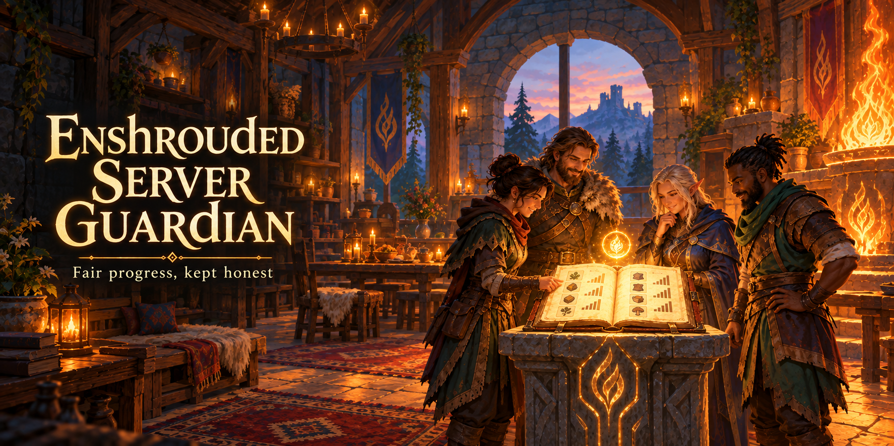

<p align="center">
  
</p>

<h1 align="center">Enshrouded Server Guardian</h1>

<p align="center">
  <b>Progresso justo no seu servidor dedicado.</b><br>
  O servidor passa a ser a autoridade sobre o personagem de cada jogador — e não o PC de quem entra.
</p>

<p align="center">
  <a href="../../releases/latest"></a>
  <a href="../../actions/workflows/build.yml"></a>
  
  
  <a href="LICENSE"></a>
</p>

<p align="center">
  🇧🇷 Português · 🇺🇸 <a href="README.md">English</a>
</p>

---

## 🔥 De onde veio

Quatro amigos num servidor dedicado. Dois problemas apareceram:

1. **Personagem de outro lugar.** O Enshrouded guarda o personagem no **cliente** e o envia ao entrar. Dava para
   jogar num mundo privado, se equipar lá e entrar no servidor compartilhado com aquele equipamento. Ou restaurar
   um backup local antigo e desfazer uma morte.
2. **Progresso acima do grupo.** Um jogador liberou receitas e itens de zonas muito à frente de onde o grupo
   estava. Limpar isso não adiantava enquanto qualquer um pudesse trazer de volta.

Os dois vêm da mesma raiz: **o cliente era a fonte de verdade do personagem**. O guardião inverte isso. O servidor
mantém a própria cópia do que gravou por último de cada jogador — e essa cópia vence.

## ✨ O que ele faz

| | |
|---|---|
| 🛡️ **Servidor manda** | na entrada, compara o personagem que chegou com a última cópia do servidor e, se divergirem, devolve a cópia do servidor |
| 🎒 **Nada vem de fora** | equipamento, nível, árvore de habilidades, inventário, descobertas e receitas valem o que o servidor viu |
| 🔍 **Prova de tudo** | guarda o save recusado **e** a cópia de referência daquele instante, para comparar sem conclusão errada |
| 👀 **Modo observar** | registra cada divergência sem mudar nada — para medir antes de impor |
| ✅ **Troca conferida** | depois de escrever, relê e compara; se não pegou, registra a falha em vez de fingir |
| 🔧 **Sobrevive a atualizações** | ganchos achados por padrão de bytes, não por endereço fixo |
| 🧩 **Combina com o Save Editor** | edite a cópia de um jogador, expulse ele, e ele volta com a sua versão |

## 🚀 Instalação

1. Baixe o **`dbghelp.dll`** na página de **[Releases](../../releases/latest)**.
2. **Pare** o servidor.
3. Coloque o arquivo na pasta do servidor, ao lado do `enshrouded_server.exe`.
4. Suba o servidor. A pasta `guardiao-dados/` aparece na primeira entrada de um jogador.

Funciona também com o servidor rodando sob **Wine** em Linux, sem opção extra — é o próprio servidor que pede o
`dbghelp.dll`. Scripts de conveniência para quem hospeda em casa estão em [`install/`](install/).

### 🟣 Na BisectHosting

A BisectHosting tem um carregador de DLLs próprio, então o arquivo vai em outro lugar:

1. **Pare** o servidor.
2. Envie o **`dbghelp.dll`** para a pasta **`DLLMods/`** — **não** ao lado do `enshrouded_server.exe`.
3. Suba o servidor. A pasta `guardiao-dados/` e o `guardiao.json` continuam ao lado do `enshrouded_server.exe`.

A ordem e o momento de carga podem ser ajustados em `DLLMods/chainloader.ini`, que também tem uma opção de atraso
para DLLs que precisam do executável do servidor totalmente carregado. O guardião normalmente não precisa de ajuste.
Para confirmar que está ativo, abra `guardiao-dados/guardiao.log`: deve aparecer `instalado`. Se aparecer
`não achei os pontos de ligação`, dê a ele um atraso no `chainloader.ini`.

> ⚠️ **Em outros hosts gerenciados, confira se eles deixam você manter o seu `dbghelp.dll`.** Alguns trocam esse
> arquivo a cada boot, porque o carregador de mods deles usa o mesmo nome.

### Hosts que testamos

| host | resultado |
|---|---|
| **Nodecraft** | ✅ funciona — o `dbghelp.dll` fica onde foi posto e carrega no boot |
| **Hospedagem própria (Windows)** | ✅ funciona, sem ressalva |
| **VPS Linux + Wine** | ⚠️ funciona, mas rodou mal para nós (o `wineserver` virou gargalo; `ntsync` exige kernel ≥ 6.14) |
| **BisectHosting** | ✅ funciona — envie para `DLLMods/` em vez de ao lado do executável ([detalhes](#-na-bisecthosting)) |

Medido no servidor dedicado do 1.0. Host fora da lista? Ponha a DLL, suba o servidor e veja se
o arquivo continua lá.

### 🎚️ Escolhendo o modo

O guardião tem dois modos, escolhidos por um arquivo `guardiao.json` na raiz do servidor, ao lado do
`enshrouded_server.exe`:

| modo | `guardiao.json` | o que acontece quando um jogador entra com um personagem diferente da cópia do servidor |
|---|---|---|
| 🛡️ **Aplicar** (padrão) | `{ "modo": "aplicar" }` — ou nenhum arquivo | a cópia do servidor é posta de volta, e o save recusado fica guardado como prova |
| 👀 **Observar** | `{ "modo": "observar" }` | só é registrado em `guardiao-dados/registro.jsonl`; nada é alterado |

Para trocar: **pare** o servidor, edite ou crie o `guardiao.json` e **suba** de novo. O modo só é lido no boot.
O `guardiao-dados/guardiao.log` mostra qual modo está ativo (`instalado; modo aplicar` ou `modo observar`).

Um bom começo num servidor que já tem jogadores: rode em **observar** por algumas sessões, veja no `registro.jsonl`
quem seria afetado e depois troque para **aplicar**. Há um arquivo de exemplo em
[`install/examples/guardiao.json`](install/examples/guardiao.json).

## ⚙️ Como funciona

<details>
<summary><b>Os ganchos</b></summary>
<br>

O servidor carrega o `dbghelp.dll` ao subir — uma biblioteca comum do Windows —, então uma DLL com esse nome na
pasta do servidor é carregada também. O guardião repassa ao `dbghelp.dll` verdadeiro a única função que o servidor
quer (`MiniDumpWriteDump`) e instala três ganchos:

1. **Início de sessão** — o log que anuncia a entrada de um jogador, onde a Steam ID aparece e é amarrada à sessão.
2. **Leitura do save** — logo depois que o servidor lê o save de personagem que o cliente mandou.
3. **Escrita do save** — onde o servidor monta um save de personagem, que é como o guardião aprende a versão dele.

Os ganchos são achados **por padrão de bytes**. Foi assim que a DLL sobreviveu a uma atualização do servidor (build
1273043) sem recompilar. Se um padrão ficar ambíguo ou sumir, ela não instala aquele gancho em vez de remendar o
lugar errado.
</details>

<details>
<summary><b>As decisões a cada entrada</b></summary>
<br>

| decisão | significado |
|---|---|
| `primeira_entrada` | ainda não havia cópia; o que o cliente mandou vira a base |
| `igual` | bate byte a byte com a cópia guardada; nada a fazer |
| `substituido` | divergem; a cópia guardada é escrita no servidor e conferida |
| `divergente_observado` | divergem, mas o modo é observar, então só registra |

Se a escrita não pegar, ele registra `substituicao_falhou`.
</details>

<details>
<summary><b>O que ele guarda</b></summary>
<br>

Por jogador, em `guardiao-dados/<steamid>/`:

- `A.bin` — o personagem: nível, xp, árvore de habilidades, equipamento, inventário
- `K.bin` — o conhecimento: descobertas e receitas
- `meta.json` — versão, tamanhos e data da cópia
- `recusados/<carimbo>_substituido.bin` — o save que o cliente mandou e foi recusado
- `recusados/<carimbo>_referencia.bin` — a cópia que o servidor tinha naquele instante

E um `guardiao-dados/registro.jsonl`, uma linha por evento.

A referência ao lado do recusado importa mais do que parece: sem ela, comparar uma recusa de horas atrás com a cópia
de agora mistura "o que o jogador trouxe" com "o que ele jogou depois".
</details>

## 🚫 O que ele não faz

- **Não é anti-cheat geral.** O que o jogador fizer na sessão é mantido — inclusive o que um trainer fizer enquanto
  ele está conectado.
- **Não toca no mundo:** construções, baús e tudo fora dos blocos de personagem e de conhecimento ficam como estão.
- **Não fala com a rede** nem com serviço nenhum. Só lê e escreve na pasta do servidor.
- **Depende das entranhas do servidor.** Se uma atualização mover os padrões, os ganchos não se instalam e a DLL
  sai do caminho.

## 🛠️ Compilando

Todo release é compilado pelo **GitHub Actions** a partir deste repositório, com [log público](../../actions/workflows/build.yml).
É de propósito: é uma DLL que entra num servidor de jogo, e ninguém deveria rodar uma baixada de um desconhecido sem
poder ver o que ela faz. O código inteiro está aqui — cinco arquivos, cerca de 700 linhas de Rust.

Localmente, com Rust para `x86_64-pc-windows-msvc`:

```
cargo build --release      # target/release/dbghelp.dll
```

## 🧩 Da mesma família

| | |
|---|---|
| 💾 **[Enshrouded Save Editor](https://github.com/nicolasferreiraxn/Enshrouded-Save-Editor)** | edite o personagem com uma interface que parece o jogo — e, com o guardião, as cópias do servidor |
| 🗺️ **[Enshrouded Interactive Map](https://github.com/nicolasferreiraxn/Enshrouded-Interactive-Map)** | mapa em tempo real no segundo monitor: sua posição, amigos e tudo o que já foi feito |

## ❤️ Créditos

- Os formatos dos blocos de personagem e de conhecimento foram descobertos por medição; nada é copiado do código do jogo.
- **[kfc-parser / Enshrouded Mod Loader](https://github.com/Brabb3l/kfc-parser)**, do brabb3l — usado para ler os recursos do jogo.
- **BisectHosting** — o Jake e o Dylan entraram em contato, deixaram o guardião compatível com o carregador de DLLs
  deles e explicaram como instalar por lá. Obrigado por cuidarem da comunidade! 💜
- **Keen Games** — pelo Enshrouded.

---

<p align="center">
  <sub>
    Projeto de fã, sem vínculo com a Keen Games. Sem suporte oficial — use, leia, modifique e publique à vontade.<br>
    Código sob <a href="LICENSE">MIT</a>.
  </sub>
</p>
